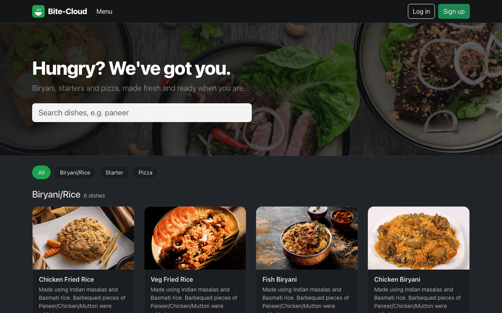
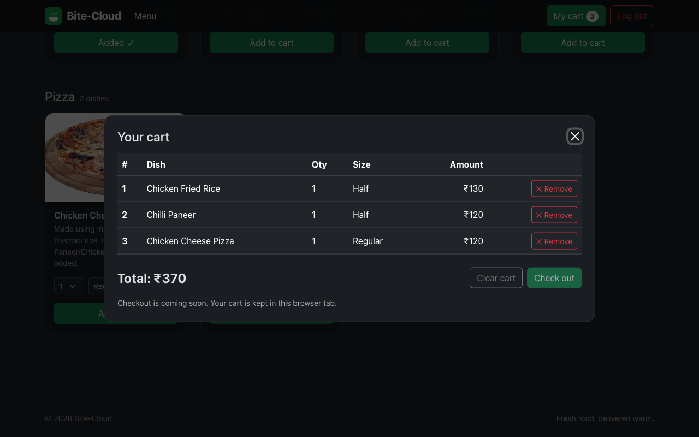
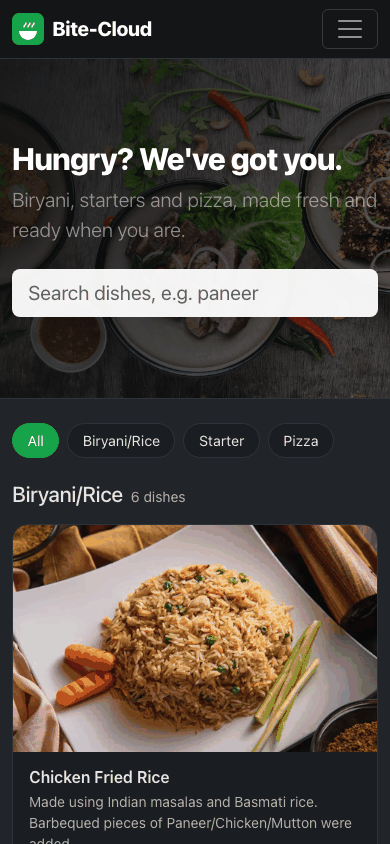

# Bite-Cloud

A MERN food ordering app: browse a categorized menu stored in MongoDB, search dishes, pick a size and quantity, and manage a cart.




| Cart | Mobile |
| ---- | ------ |
|  |  |

## Overview

Bite-Cloud has two parts. `frontend/` is a React (Create React App) client, and `backend/` is an Express API backed by MongoDB. The home page loads food categories and food items from the API and groups the items by category. Users can sign up and log in, and logged-in users get a cart.

## Features

- Hero banner with a search box that filters dishes by name, plus category filter chips.
- Menu grouped by category (Biryani/Rice, Starter, Pizza in the sample data), with each item's image, description and its real size options (half/full or regular/medium/large).
- Food cards with quantity and size selectors. The price updates as you change them.
- A cart (React Context + `useReducer`) in a modal: add items (the same dish and size are merged), remove items, clear the cart and see the total.
- Sign up and log in with request validation (`express-validator`), bcrypt password hashing and a JWT (7-day expiry) stored in `localStorage`. Errors are shown inline.
- Loading, empty and error states for the menu, and a dark Bootstrap 5.3 theme (`data-bs-theme="dark"`).
- A seed script that loads a sample menu into MongoDB.

## Tech stack

| Layer    | Technology                                                           |
| -------- | -------------------------------------------------------------------- |
| Frontend | React 18, React Router 6, React Bootstrap, Bootstrap 5.3             |
| Backend  | Node.js, Express 4, express-validator, bcryptjs, jsonwebtoken, cors, dotenv |
| Database | MongoDB (Atlas or local) with Mongoose 7                             |

## Project structure

```
Bite-Cloud/
├── backend/
│   ├── data/foodItems.json # sample menu used by the seed script
│   ├── models/             # User, food_category, food_items schemas
│   ├── routes/
│   │   ├── CreateUser.js   # sign up / log in
│   │   └── DisplayData.js  # menu data
│   ├── config.js           # reads and validates environment variables
│   ├── db.js               # MongoDB connection
│   ├── seed.js             # loads data/foodItems.json into MongoDB
│   └── index.js            # Express entry point
└── frontend/
    ├── public/
    └── src/
        ├── api.js          # API base URL and fetch helper
        ├── components/     # Navbar, Card, Footer, ContextReducer (cart)
        ├── screens/        # Home, Login, Signup, Cart, AuthLayout
        └── Modal.js
```

## Getting started

### Prerequisites

- Node.js 18 or later and npm
- A MongoDB database (local `mongod` or MongoDB Atlas)

### Backend

```bash
cd backend
cp .env.example .env     # then edit the values
npm install
npm run seed             # optional: load the sample menu (replaces existing menu data)
npm run dev              # or: npm start — runs on http://localhost:5000
```

The server exits with a clear message if `MONGO_URI` or `JWT_SECRET` is missing.

### Frontend

```bash
cd frontend
npm install
npm start                # http://localhost:3000
```

In development the CRA proxy forwards `/api/*` to `http://localhost:5000`, so no frontend configuration is needed. For a production build, set `REACT_APP_API_URL` to the deployed API origin before `npm run build`.

Other scripts: `npm test` (Jest + Testing Library) and `npm run build`.

## Environment variables

Backend (`backend/.env`, see `backend/.env.example`):

| Variable      | Required | Description                                                     |
| ------------- | -------- | --------------------------------------------------------------- |
| `MONGO_URI`   | yes      | MongoDB connection string, e.g. `mongodb://127.0.0.1:27017/bitecloud` |
| `JWT_SECRET`  | yes      | Long random string used to sign login tokens                    |
| `PORT`        | no       | API port (default `5000`)                                       |
| `CORS_ORIGIN` | no       | Comma-separated allowed browser origins (default `http://localhost:3000`) |

Frontend (`frontend/.env`, see `frontend/.env.example`):

| Variable            | Required        | Description                                         |
| ------------------- | --------------- | --------------------------------------------------- |
| `REACT_APP_API_URL` | production only | Backend origin, e.g. `https://your-api.example.com` |

## API

| Method   | Path              | Purpose                                                   |
| -------- | ----------------- | --------------------------------------------------------- |
| POST     | `/api/createUser` | Register a user (`name`, `email`, `password`, `location`) |
| POST     | `/api/loginuser`  | Log in and return `authToken` (JWT)                       |
| GET/POST | `/api/foodData`   | Return `[foodItems, foodCategories]`                      |

## Known limitations

- Checkout and order history are not implemented. The cart lives in browser memory and is cleared on reload.
- The JWT is stored in `localStorage` and is not yet required by any API route.
- Dish images are hot-linked from Unsplash, iStock and Pixabay. One sample image no longer loads and shows a placeholder.
- `npm audit` still reports issues in Create React App's build tooling (`react-scripts` 5) that can only be fixed with a breaking upgrade.
